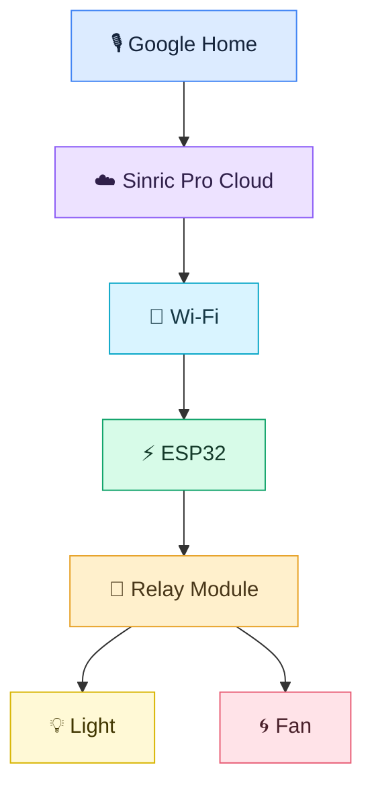

# ⚡ Voice-Controlled Smart Home Automation

### 🏠 Your Voice. Your Home. Your Control.

A simple and affordable IoT project that lets you control your **light 💡 and fan 🌀 using voice commands** with ESP32, Wi-Fi, Sinric Pro, and Google Home.

 

**Simple Setup • Smart Control • Low-Cost Design**

---

## 📑 Table of Contents

- [🌟 About the Project](#-about-the-project)
- [✨ Features](#-features)
- [🛠️ Components Required](#️-components-required)
- [🧠 System Architecture](#-system-architecture)
- [📚 Libraries Used](#-libraries-used)
- [🔌 Pin Connections](#-pin-connections)
- [🚀 Getting Started](#-getting-started)
- [🎙️ Voice Commands](#️-voice-commands)
- [✅ Project Result](#-project-result)
- [🔮 Future Improvements](#-future-improvements)

---

## 🌟 About the Project

Imagine controlling your home appliances without pressing a switch!

This project uses an **ESP32 microcontroller** to control a light and a fan through voice commands. Google Home receives your command, while Sinric Pro connects the voice-control system to the ESP32 over Wi-Fi.

🎯 **Our goal:** To demonstrate how everyday appliances can be controlled using affordable IoT technology.

## ✨ Features

| Feature | Description |
|---|---|
| 🎙️ Voice Control | Control appliances using spoken commands |
| 💡 Light Control | Switch the light ON or OFF |
| 🌀 Fan Control | Switch the fan ON or OFF |
| ☁️ Cloud Connectivity | Communicate through Sinric Pro |
| 📶 Wireless Operation | Connect through Wi-Fi |
| 💰 Budget-Friendly | Uses common electronic components |

---

## 🛠️ Components Required

| Component | Function |
|---|---|
| ⚡ ESP32 | Main controller |
| 🔌 2-Channel 5V Relay | Switches the appliances |
| 🧵 Jumper Wires | Connect the circuit |
| 💡 Light | Controlled appliance |
| 🌀 Fan | Controlled appliance |
| 🔋 Power Supply | Provides power |

## 🧠 System Architecture

The command travels from your voice assistant to the physical appliance.

### ⚙️ How It Works

1. Speak a command to Google Home.
2. Sinric Pro processes the command through the cloud.
3. The ESP32 receives the command over Wi-Fi.
4. The relay switches the selected appliance ON or OFF.

---

## 📚 Libraries Used

| Library | Purpose |
|---|---|
| `Arduino.h` | Provides basic Arduino functions |
| `WiFi.h` | Connects ESP32 to Wi-Fi |
| `SinricPro.h` | Connects ESP32 to Sinric Pro |
| `SinricProSwitch.h` | Handles light and fan switch commands |
| `ArduinoJson` | Supports JSON data handling |
| `WebSockets` | Supports real-time communication |

**Installation:** Install the ESP32 board package and the SinricPro library through Arduino IDE's Library Manager. Install any additional dependencies required by your installed SinricPro version.

## 🔌 Pin Connections

| Appliance | ESP32 Pin | Function |
|---|---|---|
| 💡 Light | `GPIO 13` | Light control |
| 🌀 Fan | `GPIO 14` | Fan control |

---

## 🚀 Getting Started

### 1️⃣ Install the Software

Install Arduino IDE, the ESP32 board package, and the required libraries.

### 2️⃣ Configure the Credentials

Add your Wi-Fi details, Sinric Pro App Key, App Secret, and device IDs to the code.

### 3️⃣ Connect the Hardware

Connect the ESP32 to the two-channel relay module according to your circuit diagram.

### 4️⃣ Upload the Program

Connect the ESP32 to your computer, select the correct board and port, then upload the code.

### 5️⃣ Connect Google Home

Link your Sinric Pro account with Google Home and configure your devices.

### 6️⃣ Test Your Project

Speak the commands below and check whether the correct appliance responds.

---

## 🎙️ Voice Commands

| 🗣️ Say This | 🎯 Expected Action |
|---|---|
| "Hey Google, turn on the light" | 💡 Light ON |
| "Hey Google, turn off the light" | 🌑 Light OFF |
| "Hey Google, turn on the fan" | 🌀 Fan ON |
| "Hey Google, turn off the fan" | ⏹️ Fan OFF |

---

## ✅ Project Result

The project demonstrates how an ESP32-based IoT system can control a light and a fan through voice commands. It combines wireless connectivity and cloud communication to bring basic smart home automation to life.

## 🔮 Future Improvements

- 🏡 Add more home appliances.
- 📱 Include mobile-based monitoring and control.
- 📊 Add electricity consumption monitoring.
- 🤖 Expand the system with additional smart home features.

---

## 🔐 Security First

Never publish your real Wi-Fi password or Sinric Pro App Secret in a public repository. Replace private credentials with placeholders before uploading the code to GitHub, and rotate any credentials that have already been exposed.

---

### 💙 Built with ESP32 | Powered by IoT

**Making everyday life smarter, one voice command at a time.** ⚡

