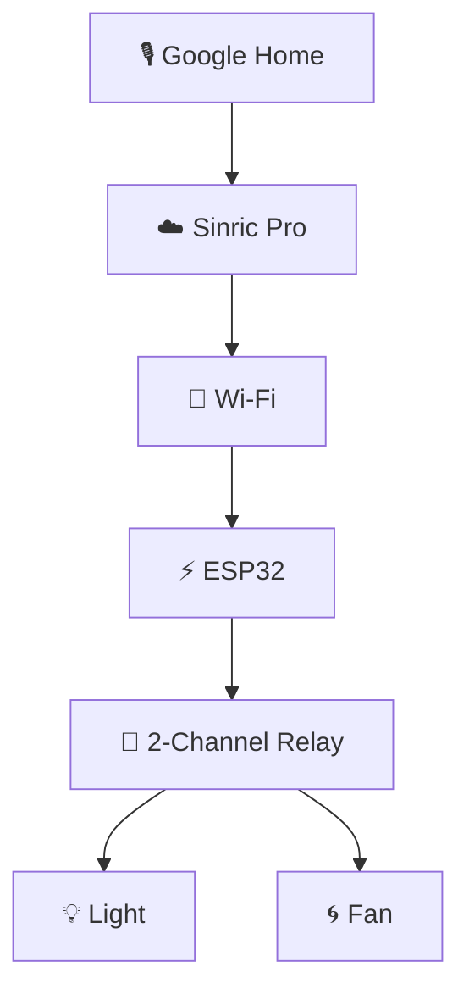

# ⚡ Voice-Controlled Devices Using Google Assistant

### 🏠 A Simple Smart Home Automation Project

Control your **light and fan using voice commands** with an ESP32, Wi-Fi, Sinric Pro, and Google Home.

---

## 📌 About the Project

This project makes controlling home appliances easier using voice commands. An ESP32 connects to Wi-Fi and communicates with Sinric Pro, allowing Google Home to control a light and a fan.

🎯 **Main Goal:** Build a simple, affordable, and easy-to-use smart home automation system.

## ✨ Key Features

- 🎙️ **Voice Control** — Switch appliances on or off using voice commands.
- 📶 **Wi-Fi Connectivity** — Connect the ESP32 to the internet.
- 💡 **Two-Device Control** — Operate a light and a fan independently.
- ☁️ **Cloud Integration** — Use Sinric Pro to connect the ESP32 with Google Home.
- 💰 **Low-Cost Design** — Built using commonly available electronic components.

## 🛠️ Hardware Components

| Component | Purpose |
|---|---|
| ESP32 Development Board | Main controller |
| 2-Channel 5V Relay Module | Switches the light and fan |
| Jumper Wires | Connect the components |
| Light and Fan | Devices being controlled |
| Power Supply | Powers the circuit |

## 📚 Libraries Used

| Library | Purpose |
|---|---|
| `Arduino.h` | Provides basic Arduino functions |
| `WiFi.h` | Connects the ESP32 to Wi-Fi |
| `SinricPro.h` | Connects the ESP32 to Sinric Pro |
| `SinricProSwitch.h` | Handles appliance switch control |
| `ArduinoJson` | Handles JSON data |
| `WebSockets` | Supports cloud communication |

**Note:** `Arduino.h` and `WiFi.h` are provided by the ESP32 board package. Install the SinricPro library through the Arduino IDE Library Manager and ensure its required dependencies are installed.

## ⚙️ How It Works

1. Speak a command to Google Home.
2. Sinric Pro processes the command through the cloud.
3. The ESP32 receives the command over Wi-Fi.
4. The relay switches the selected appliance ON or OFF.

## 🔌 Pin Connections

| Appliance | ESP32 GPIO Pin |
|---|---|
| 💡 Light | `GPIO 13` |
| 🌀 Fan | `GPIO 14` |

## 💻 Software Requirements

- Arduino IDE
- ESP32 board package
- Sinric Pro account and library
- Google Home app or compatible Google Home device

## 🚀 Getting Started

**Step 1 — Install the Software**

Install Arduino IDE, the ESP32 board package, and the required libraries.

**Step 2 — Configure Your Credentials**

Add your Wi-Fi details, Sinric Pro App Key, App Secret, and device IDs to the code.

**Step 3 — Upload the Code**

Connect your ESP32 to your computer and upload the program through Arduino IDE.

**Step 4 — Connect Google Home**

Link your Sinric Pro account with Google Home and set up your devices.

**Step 5 — Test the Project**

Use the supported voice commands to control the light and fan.

## 🎙️ Voice Commands

| Voice Command | Action |
|---|---|
| 🟢 "Hey Google, turn on the light" | Switches the light ON |
| 🔴 "Hey Google, turn off the light" | Switches the light OFF |
| 🟢 "Hey Google, turn on the fan" | Switches the fan ON |
| 🔴 "Hey Google, turn off the fan" | Switches the fan OFF |

## ✅ Project Result

The project demonstrates how an affordable IoT system can control a light and a fan using voice commands. It combines ESP32, Wi-Fi, Sinric Pro, and Google Home to demonstrate the basic concept of smart home automation.

## 🔮 Future Improvements

- ➕ Add more home appliances.
- 📱 Add device monitoring through a mobile app.
- 🏡 Expand the system into a larger smart home network.
- 📊 Add energy monitoring features.

## 🔐 Security Notice

**Never upload your real Wi-Fi password, Sinric Pro App Secret, or other private credentials to a public GitHub repository.** Use placeholders or secure configuration methods instead.

---

### 💙 Built with ESP32 and IoT Technology

*Making everyday device control smarter, simpler, and more convenient.*

